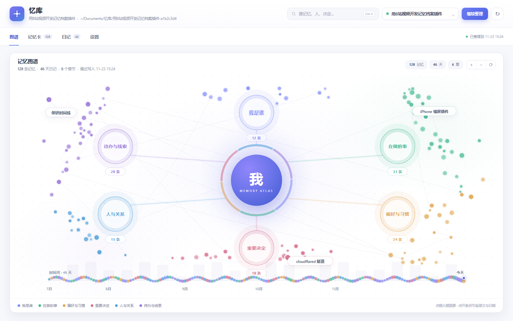

# 忆库 · dsh-memory-atlas

把 DSH 的会话熬成一份**能带走的长期记忆**：按天存下的原始对话、每天一篇日记、一本六章的记忆卡，以及一张可以缩放、点开、搜索的记忆图谱。

它解决的是同一个问题：上下文会满、会话会换，但「你是谁、你在做什么、你偏好什么、你们之前决定过什么」不该跟着消失。

仓库：[github.com/zdddrszj985/dsh-memory-atlas](https://github.com/zdddrszj985/dsh-memory-atlas)

---

## 它做什么

- **一个会话一份档案**。档案是一个普通文件夹，可以直接看、直接备份、直接搬走。
- **按天存档**。每天一份原始对话（只留真人发言和助手正文，工具输出、推理过程、注入的上下文全部滤掉）。
- **两次提炼**。同一天先由模型写成日记，再抽出长期有用的条目并进记忆卡；条目按「我是谁 / 在做的事 / 偏好与习惯 / 重要决定 / 人与关系 / 待办与线索」六章归档。
- **逐日落盘、可续跑**。整理到哪天记在账本里；中途停掉、关掉 DSH、模型报错，已经写完的天不会重做。每次默认最多 20 天，跑完再点一次「继续整理」接着补更早的。
- **`/yiku` 回读**。在任意会话里输入 `/yiku`，插件会把记忆卡和最近 3 天日记的**路径**递给当前助手，让它自己 `read`。不把整本记忆灌进上下文。
- **按需检索**。两个工具让助手在聊到旧事时自己翻档案：
  - `atlas_search`：在记忆卡、日记、原始对话里搜关键词，返回带出处的片段；
  - `atlas_read`：读整本记忆卡，或某一天的日记 / 原始对话。
- **可视化**。侧栏「忆库」打开整页：中心是「我」，六章向外展开，条目是节点；底部时间河按天排日记。支持缩放、拖动、悬停、点开条目、搜索高亮。

## 界面

下图为示意：档案积累到 128 条记忆、46 天日记时的记忆图谱（非真实数据）。中心是「我」，六章向外展开，每个小点是一条记忆，底部时间河按天排日记。



## 安装

要求：DSH >= 0.2.0，Node >= 22。

### 方式一：DSH CLI（推荐）

```bash
git clone https://github.com/zdddrszj985/dsh-memory-atlas.git
dsh plugin --profile desktop add ./dsh-memory-atlas
```

`add` 后面的路径换成你实际克隆到的目录即可。装完重启 DSH（或让 HMR 接管），侧栏会出现「忆库」。

如果侧栏没出现，检查 `~/.dsh/profiles/<profile>/package.json` 的 `dsh.profile.bundles` 数组里有没有 `dsh-memory-atlas`；没有就手动补上再重启。

### 方式二：手工 link（没有 CLI 时）

在 profile 目录里建一个链接，并把包名写进 profile 的 `package.json`：

1. 建 junction：
   ```powershell
   New-Item -ItemType Junction -Path "$env:USERPROFILE\.dsh\profiles\desktop\node_modules\dsh-memory-atlas" -Target "C:\plugins\dsh-memory-atlas"
   ```
2. 编辑 `$env:USERPROFILE\.dsh\profiles\desktop\package.json`：
   - `dependencies` 里加 `"dsh-memory-atlas": "link:C:/plugins/dsh-memory-atlas"`；
   - `dsh.profile.bundles` 数组里加 `"dsh-memory-atlas"`。
3. 重启 DSH。

## 开始用

1. 打开侧栏「忆库」。
2. 顶部下拉选一个会话（默认最近活跃的）。列表里带 `●` 的表示已经建过档案。
3. 第一次点「开始整理」：会在 `Documents/忆库/<会话标题>-<id前8位>/` 建档案，然后开始整理。也可以到「设置」里自己选文件夹、改默认位置、换模型。
4. 整理时能看到进度条、当前日期和阶段，可以随时「停止」。停止不会丢已经写完的天。
5. 整理完切到「图谱」「记忆卡」「日记」看结果；在搜索框里搜词会高亮命中的条目和片段。
6. 回到任意会话，输入 `/yiku`，助手就会先读记忆卡和最近几天日记再回你。

> `/yiku` 只在**已经整理出内容**时才会开一个新回合；空档案只提示你先去整理。

## 档案长什么样

```text
Documents/忆库/用B站视频开发记忆档案插件-1a2b3c4d/
├─ 记忆卡.md          # 六章，### 条目标题 + 正文 + <!-- d:日期 i:重要度 -->
├─ 日记/
│  ├─ 2026-11-23.md   # 当天概述 + 时间线 + 今天记下的条目
│  └─ 2026-11-22.md
├─ 原始对话/
│  ├─ 2026-11-23.md   # 当天真人发言与助手正文
│  └─ 2026-11-22.md
└─ .atlas.json        # 账本：整理到哪天、水位、每天的状态/条数/字数/错误
```

记忆卡是纯 Markdown，可以直接手改；下一次整理会读回来再合并。同章同题（或标题高度相似）的条目会更新而不是重复添加，每章最多保留 80 条。

## 整理是怎么跑的

- 读取 `~/.dsh/sessions/**/session.v4.jsonl.zstd`，日志是首尾相接的多个 zstd 帧，逐帧解。
- 只收 `user/message` 里 `source.kind === 'user'` 的真人发言，以及 `assistant/message` 的正文块；工具调用、推理、注入上下文不进档案。
- 按本地日期分组，优先整理最旧的天；一天太长会切成最多 4 段分别请模型整理，再合并结果。
- 每天的结果是严格 JSON：`{title, diary, cards[], events[]}`。解析失败会重试一次；仍失败就记下错误、保留当天原始对话，下次可以重做。
- 模型默认跟随 DSH 当前默认模型，也可以在「设置」里固定 provider/model。所有调用都走 DSH 自己的 `llm` 服务。

## 隐私

- 档案全部在本地文件夹里，没有外部网络请求、没有云端同步、没有遥测。
- 唯一的数据出口是 DSH 已经配置好的模型服务：整理时把当天对话发给它。介意的话可以在「设置」里换成自己的本地模型 provider。
- 原始对话文件是明文的，注意别把档案目录放进公开仓库。

## 工具与接口

助手工具：

| 工具 | 参数 | 作用 |
| --- | --- | --- |
| `atlas_search` | `query`（必填）、`date`、`scope=all/card/diary/raw`、`limit` | 搜记忆卡/日记/原文，按相关度返回片段和出处 |
| `atlas_read` | `what=card/diary/raw`（必填）、`date` | 读整本记忆卡或某天的日记/原文（单次截断 24000 字） |

面板走宿主本机 HTTP：`/api/memory-atlas/{status,sessions,archives,models,archive,diary,raw,search,pickdir,bind,unbind,config,distill,stop,job}`，只接受本机同源请求。

## 开发与自测

```bash
cd dsh-memory-atlas
npm test
```

自测覆盖：多帧 zstd 解码、真人发言过滤、按天分组、记忆卡解析/渲染/合并、模型 JSON 容错、长对话切段、档案读写与检索、`extractDay` 重试、整理任务逐日落盘与续跑、假 ctx 下的路由/工具/指令注册、客户端与入口语法。

## 已知边界

- 只有 DSH 已经落盘的会话才能整理；正在进行的会话在下次落盘后才完整。
- 一天的消息太多时只切 4 段，极端长的一天可能丢掉最后一些内容的细节（原始对话仍然完整）。
- 记忆卡合并靠标题相似度，模型如果给同一条起了完全不同的标题，可能会留下两条。
- 图谱每章最多画 16 个条目节点，完整条目在「记忆卡」页签里。

## 许可

MIT。界面与代码均为本插件原创；没有复制第三方插件源码。
